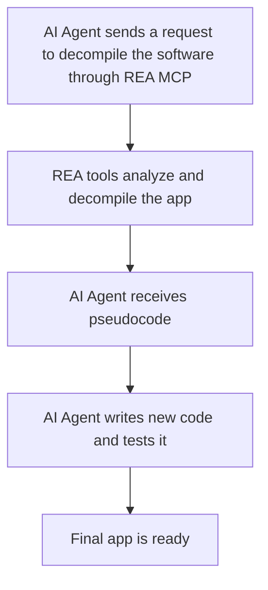

# REVERSE ENGINEER ANYTHING (REA): IMPACT ON DEVELOPERS
The fact that others can more easily recreate a program developed by someone else is a disadvantage in the industry. However, reverse engineering can also be useful for improving existing software.  

Evidently, if an AI agent can create a similar version of a program just by observing how it works, without accessing the original source-code, then the software itself becomes less unique and valuable.  

## HOW REA WORKS: AN ALLY OR AN ENEMY FOR DEVELOPERS?
REA is an open-source toolkit that combines AI coding agents, such as Claude Code and Codex, with analysis tools like Ghidra and Hopper through MCP, to decompile and rebuild software.  

*Model Context Protocol (MPC):*
>  “[…] standardized way for AI applications to connect to external tools, data, and services—often called "the USB-C port for AI.” (Chapman, 2026)  

### PROCESS:  

1.	**Inspect:** REA analyzes program components, such as JavaScript and binaries
2.	**Understand:** The AI coding agent uses REA’s output to understand the application’s functions, dependencies, and behavior
3.	**Rebuild:** The AI coding agent uses this information to write and assess new code.  

![REA workflow] (https://raw.githubusercontent.com/morluto/rea/refs/heads/main/website/public/assets/figures/rea-investigation-flow.svg)  

### Example of REA’s Application  
*Produced by: Abid Ali Awan (2026)*  
[Reverse Engineer Chrome’s Dinosaur Game] (https://www.datacamp.com/tutorial/reverse-engineer-anything-rea-tutorial)

## IS REA REALLY USEFUL FOR DEVELOPERS?  

| **ADVANTAGES** | **DISADVANTAGES** |
|---|---|
| Useful to investigate abandoned software. | Older systems may contain inefficient code structures, making them difficult to understand and analyze. |
| Recreate useful functionalities with improvements. | **Copyright:** Developers should avoid completely cloning a program with only minor changes. Instead, they should use REA to innovate and improve their own products. |
| No advanced technical knowledge is required; users can give prompts in human language. | **Accuracy limitations:** Rebuilding an application accurately remains a weakness of REA, so developers may still struggle to understand how a program works. 
> “Thomas has also retreated from his pledge to match Adobe’s feature set within a month, and now says it will take months” (Tsagkarakis, 2026). |
| **New job opportunities:** Companies still need developers with legacy code skills to review AI results, fix errors, and maintain complex systems. | |
| Developers can use REA to understand the architecture of poorly documented programs and improve them. | |
| Developers can use REA to identify potential security risks in their products and projects. | |

---

***ADVANTAGE / DISADVANTAGE***

REA still develops some inaccurate versions, because it cannot always recover the complete source code, and some software’s are not fully supported:
>  “On the project’s site, the apps carry ‘early alpha’ or ‘in development’ labels, and one pixel artist has already described the Photoshop clone as ‘completely unusable’” (Tsagkarakis, 2026).

## GUIDE FOR DEVELOPERS

## DEVELOPERS OPINIONS

## REFERENCES
