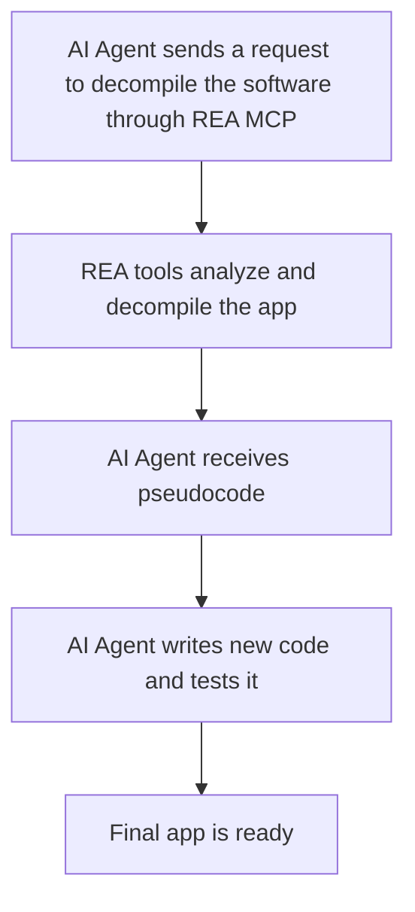

# REVERSE ENGINEER ANYTHING (REA): IMPACT ON DEVELOPERS
The fact that others can more easily recreate a program developed by someone else is a disadvantage in the industry. However, reverse engineering can also be useful for improving existing software.  

Evidently, if an AI agent can create a similar version of a program just by observing how it works, without accessing the original source-code, then the software itself becomes less unique and valuable.  

## HOW REA WORKS: AN ALLY OR AN ENEMY FOR DEVELOPERS?
REA is an open-source toolkit that combines AI coding agents, such as Claude Code and Codex, with analysis tools like Ghidra and Hopper through MCP, to decompile and rebuild software.  

*Model Context Protocol (MPC):*
>  “[…] standardized way for AI applications to connect to external tools, data, and services—often called "the USB-C port for AI.” (Chapman, 2026)  

### PROCESS:  

1.	**Inspect:** REA analyzes program components, such as JavaScript and binaries
2.	**Understand:** The AI coding agent uses REA’s output to understand the application’s functions, dependencies, and behavior
3.	**Rebuild:** The AI coding agent uses this information to write and assess new code.  

![REA workflow] (https://raw.githubusercontent.com/morluto/rea/refs/heads/main/website/public/assets/figures/rea-investigation-flow.svg)  

### Example of REA’s Application  
*Produced by: Abid Ali Awan (2026)*  
[Reverse Engineer Chrome’s Dinosaur Game] (https://www.datacamp.com/tutorial/reverse-engineer-anything-rea-tutorial)

## IS REA REALLY USEFUL FOR DEVELOPERS?  

| **ADVANTAGES** | **DISADVANTAGES** |
|---|---|
| Useful to investigate abandoned software. | Older systems may contain inefficient code structures, making them difficult to understand and analyze. |
| Recreate useful functionalities with improvements. | **Copyright:** Developers should avoid completely cloning a program with only minor changes. Instead, they should use REA to innovate and improve their own products. |
| No advanced technical knowledge is required; users can give prompts in human language. | **Accuracy limitations:** Rebuilding an application accurately remains a weakness of REA, so developers may still struggle to understand how a program works. *“Thomas has also retreated from his pledge to match Adobe’s feature set within a month, and now says it will take months”* (Tsagkarakis, 2026). |
| **New job opportunities:** Companies still need developers with legacy code skills to review AI results, fix errors, and maintain complex systems. | |
| Developers can use REA to understand the architecture of poorly documented programs and improve them. | |
| Developers can use REA to identify potential security risks in their products and projects. | |

---

***ADVANTAGE / DISADVANTAGE***

REA still develops some inaccurate versions, because it cannot always recover the complete source code, and some software’s are not fully supported:
>  “On the project’s site, the apps carry ‘early alpha’ or ‘in development’ labels, and one pixel artist has already described the Photoshop clone as ‘completely unusable’” (Tsagkarakis, 2026).

## SURVIVING OR THRIVING? GUIDE FOR DEVELOPERS  

-	The user interface and features are becoming less valuable as competitive advantages since they are easier to replicate.
-	Focus on protecting the elements beyond visible software, such as proprietary data, specialized technical knowledge, unique algorithms, and complex system integrations. 
-	REA will not necessarily replace software development, but it may reduce the value of simple applications built on existing AI models. 
    > “It’s more accurate to say it’s compressing the value of thin wrapper apps and front ends built on top of existing AI models” (Chavez-Mattos, 2026)
-	Mindset shift: Traditionally, developers aim to write simple, clear, and maintainable code. However, REA creates a new challenge for developers by making them consider how to protect their projects from being replicated, without making their code unnecessarily complex, which could increase the risk of errors and make maintenance more difficult.
> “Every shortcut in the client gets found faster [...] The server boundary is the part that doesn’t get cheaper to break. Get the boundary right, and someone decompiling your app is a researcher reading your request form” (Roman, 2026).

### DEVELOPER VS REA
***Brief overview of Anti-Reverse Engineering Techniques***
-	**Inline Functions:** Make the program harder to understand by changing how functions work inside the code.
-	**Anti-Dumping:** Avoid hackers from saving a copy of the program’s memory (data used while a program is running).
-	**IA-32 Instruction Exploits:** Use special processor instructions complicate debuggers workflow.
-	**Nanomites:** Replace some jump instructions (commands that tell the program to continue executing code in another location) with breakpoints and hide jump information in an encrypted table. 

## DEVELOPERS OPINIONS  
### Brandon Thomas ~ ArtCraft creator
Background: Thomas describes himself as “a 15-year industry veteran” and says he is “not casual vibe coder.”
Perspective of REA: Thomas describes ArtCraft as a “clean-room reimplementation” of Adobe´s applications, recreating their functionality without relying on copyrighted assets or a protected codebase.
He also states: 
> “If you’re worried this is just some one-off flash in the pan that will die, it isn’t”  (Gray, 2026)

### Ivan Kutskir ~ Photopea creator
On the other hand, Kutskir expresses a more negative perspective on REA. He explains that people use AI to copy his website’s JavaScript code, remove its advertisements, and publish modified versions on GitHub. He states:  
> “Many people are asking AI models to take the Javascript code from my website, remove all ads from it, and they publish such a "new product" on Github for everyone > to download.” (Hacker News, 2026)  

Kutskir is also concerned about the impact on his reputation, explaining that users sometimes mistake modified Photopea versions with the official website.
> “[…] I want my website to be the only source of a stable version of my program Photopea. I even received emails from people complaining about something in Photopea, and it took several emails to figure out that they are not using Photopea.com (so it ruins my reputation a little). I reported it to Github on the 4th of September 2026: […] a month later, I received this response: […] based on the facts presented to us, we're unable to confirm a violation of 17 U.S. Code § 1201.” (Hacker News, 2026)

## REFERENCES
